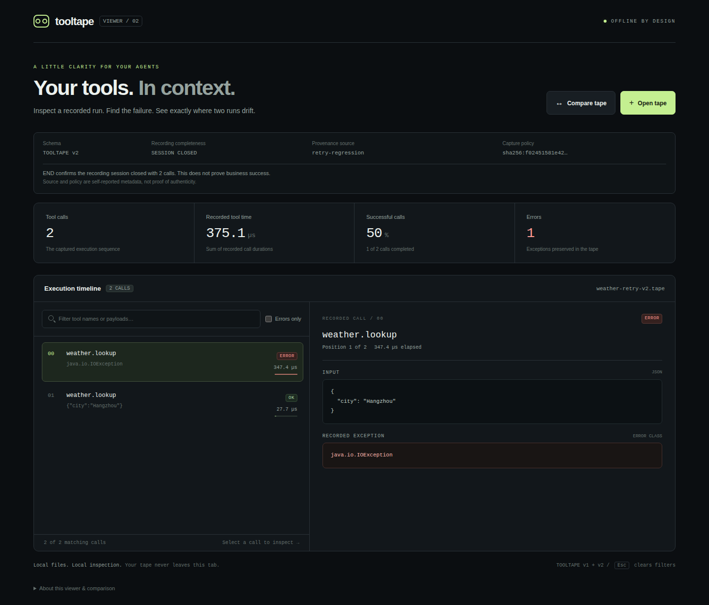
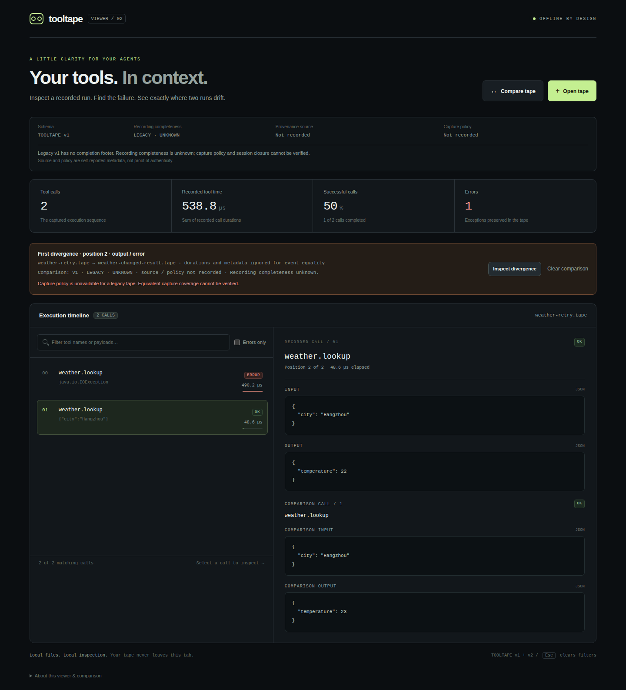
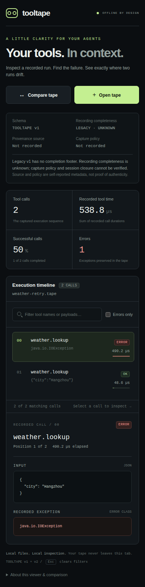
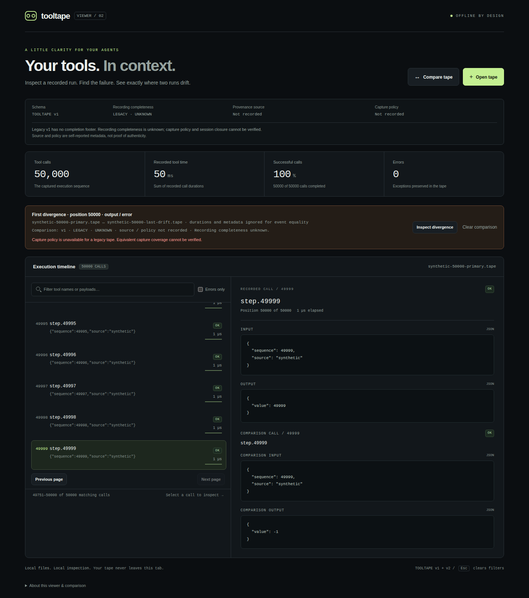

<div align="center">

# ToolTape
### One failure. A repeatable regression.

**Record serial tool calls · Replay offline · Find the first divergence**

[English](README.md) | [简体中文](README.zh-CN.md)

[](https://github.com/keweizhuazuki/tooltape/actions/workflows/ci.yml) [](https://github.com/keweizhuazuki/tooltape/actions/workflows/browser.yml)

[Quick start](#quick-start) · [API](#use-it-in-your-code) · [JUnit fixtures](docs/JUNIT.md) · [Security](SECURITY.md) · [Format](docs/FORMAT.md) · [Roadmap](#next-upgrade)

</div>

ToolTape turns a Java tool boundary into a reusable test fixture. Record the order, selected arguments, results and exception types once; rerun your orchestration against an offline stub that fails at the first unexpected tool call or argument. No server, account, API key or runtime dependency.

> **Scope:** v0.2 is for serial tool orchestration. It does not record/replay an LLM, stream tokens, reproduce concurrency, or sandbox your Java process. Route external effects through `Tool`. The default policy captures no input/output fields; explicitly allow safe scalar fields.

## A real recording, in context



Actual Chromium capture of the checked-in v2 retry fixture. [Screenshot provenance](docs/images/viewer-session.json) records the exact source commit, browser version and file hashes; [the browser run](https://github.com/keweizhuazuki/tooltape/actions/runs/38068578529) passed all 218 active checks across five engine/viewport projects.

<details>
<summary>See the first-divergence comparison and mobile layout</summary>





The mobile image is browser emulation, not a physical-device claim. PNGs are direct browser screenshots with no compositing.

</details>

<details>
<summary>Inspect the last divergence in a 50,000-call recording</summary>



Actual Chromium capture of two deterministic synthetic tapes, differing only at the last output. All five browser projects loaded the files through the public file inputs and observed at most 250 mounted call cards during navigation. This verifies bounded rendering, not a latency benchmark. [Fixture hashes and capture provenance](docs/images/viewer-large-divergence.json).

</details>

## Why use it?

- **Reproduce a failure without a live service.** A recorded timeout becomes a controlled `RecordedToolException`; the next call returns the recorded response.
- **Catch regressions at the boundary.** Tool name, allowlisted arguments, missing calls and extra calls are checked; closing a replay asserts complete consumption.
- **Review fixtures locally.** CLI validation/diff and a standalone timeline viewer need no backend.
- **Keep existing tests.** A zero-dependency core works with ordinary Java and JUnit; Spring AI integration guidance is based on a real project's dispatch path.

## Quick start

### Prebuilt CLI (Java 17+)

CI produces a verified JAR and SHA-256 checksums. It is not published on Maven Central. Tagged prereleases, when available, are listed under [Releases](https://github.com/keweizhuazuki/tooltape/releases).

The tested v0.2 build can currently be downloaded from its successful CI run:

```sh
gh run download 38046405558 --repo keweizhuazuki/tooltape --name tooltape-dist-a89ba0f9e7c625afe0263ba3940ee7d261cddf7f
sha256sum -c SHA256SUMS              # Linux; macOS: shasum -a 256 -c SHA256SUMS
java -jar tooltape-0.2.0.jar --version
java -jar tooltape-0.2.0.jar inspect path/to/your.tape
```

CI artifacts have 30-day retention and may require GitHub CLI sign-in; source builds below remain available. On Windows, compare `(Get-FileHash tooltape-0.2.0.jar -Algorithm SHA256).Hash` with the value in `SHA256SUMS` before running the JAR.

### Build from source

Install a **full JDK 17 or 21** and Git. The local viewer is included in the clone.

#### Linux / macOS

```sh
git clone https://github.com/keweizhuazuki/tooltape.git
cd tooltape
./build.sh
java -cp target/tooltape.jar:target/example-classes RetryRegression
java -jar target/tooltape.jar inspect target/weather.tape
```

#### Windows PowerShell

For portable Windows CLI jobs, use ASCII-only full paths. Hosted JDK 17/21 launchers can replace characters outside the active code page before ToolTape receives them; quoting alone does not fix this. For Unicode fixture filenames, use the UTF-8 batch manifest below with an ASCII manifest argument. UTF-8 tape contents remain supported. [Measured filename limitation →](docs/BATCH_REPORTS.md#windows-filename-transport)

```powershell
git clone https://github.com/keweizhuazuki/tooltape.git
cd tooltape
./build.ps1
java -cp 'target/tooltape.jar;target/example-classes' RetryRegression
java -jar target/tooltape.jar inspect target/weather.tape
```

The demo creates `target/weather.tape` with CREATE_NEW. To rerun, choose a fresh path: `RetryRegression target/weather-2.tape`. Existing fixtures are never silently overwritten.

### Actual demo output

```text
PASS: recorded timeout + retry, replayed offline; live calls=2
First divergence at event 0: arguments at /city
expected: {"city":"Hangzhou"}
actual:   {"city":"Shanghai"}
```

The two live calls happen during recording. Replay adds zero live calls. The changed-city variant intentionally demonstrates a regression.

## CI-friendly reports

```sh
java -jar target/tooltape.jar validate --json fixtures/weather-retry-v2.tape
java -jar target/tooltape.jar diff --json expected.tape actual.tape > report.json
```

JSON reports have a versioned contract and exit codes: **0** valid/matching, **1** first event divergence, **2** invalid input, incomplete session or incompatible v2 capture policies. Reports omit captured values, tool names, file paths and JSON key names, including on errors. Legacy v1 comparisons explicitly report unverified policy/completion. Human-readable commands remain unchanged and can expose recorded values.

For v2-only CI jobs, add `--require-v2` immediately after `--json` in either command. Legacy inputs then fail with exit 2 and `LEGACY_TAPE`, while default behavior and the report v1 structure stay unchanged. This checks schema eligibility, not authenticity or business success.

For an explicit fixture inventory, `validate-batch --json [--require-v2] <file>...` checks up to 64 files serially, collects ordinary failures and returns one index-only report with aggregate exit 0/2. Existing single-file commands stay unchanged. [Batch contract and portable CI examples →](docs/BATCH_REPORTS.md)

Unicode filenames can be listed inside an explicit UTF-8 manifest, avoiding native argv conversion for those entries:

```sh
java -jar target/tooltape.jar validate-batch --json --manifest examples/manifest/inventory.json
```

The runnable example includes `天气 重试🌧.tape`; paths are relative to the manifest, not the working directory. The manifest is bounded to 64 KiB/64 entries and has no discovery or URL loading. Its own Windows command-line path should remain ASCII. [Schema and path rules →](docs/BATCH_REPORTS.md#utf-8-manifest-unicode-filenames-without-unicode-argv)

[Report schema, compatibility rules and shell examples →](docs/CLI_REPORTS.md)

## Use it in your code

```java
CapturePolicy policy = CapturePolicy.allow(
    Set.of("city"),                 // explicitly reviewed input fields
    Set.of("temperature")           // output fields needed by the test
);

Tool live = (name, arguments) -> weatherService.lookup(arguments);
try (Recorder recorder = new Recorder(Path.of("failure.tape"), live, policy)) {
    runMyWorkflow(recorder);         // your orchestration, including retries
}

try (Replay replay = new Replay(Tape.read(Path.of("failure.tape")), policy)) {
    runMyWorkflow(replay);           // no live implementation is passed in
}                                   // fails if recorded calls remain unused
```

`Tool` accepts and returns `Map<String,Object>` of JSON-compatible data. Recorded output is sanitized, so allow the fields your workflow requires. Only explicitly allowed top-level scalars are captured; nested values become `[REDACTED]`. Credential-like field names are always excluded. Excluded input fields cannot be regression-checked.

Allowed strings are retained as supplied. The core does not automatically collect prompts, headers or exception messages, but putting that content into an allowed scalar field can record it. Review values, not just field names.

### JSON values, not Java wrapper types

Recording returns the live tool's original result. Replay returns a fresh sanitized JSON object: all numbers are `BigDecimal`, so an `Integer` cast or Java `Map.equals` comparison with the live result can fail even when the JSON values match. Numeric scale and concrete wrapper classes are not retained. Normalize results into domain types in the same workflow for recording and replay:

```java
static int exactInt(Object value) {
  if (!(value instanceof Number number))
    throw new IllegalArgumentException("Expected a JSON number");
  return new java.math.BigDecimal(number.toString()).intValueExact();
}
```

For integral domain fields, this rejects fractions and overflow; `Number.intValue()` can silently truncate. For decimal domains, retain `BigDecimal` and define the required scale/rounding explicitly. The runnable [numeric boundary example](examples/NumericBoundaryRegression.java) uses the same inventory workflow with a live `Integer` and replayed `BigDecimal`, then checks exact-conversion failures. Both build scripts execute it; run it again with `java -cp target/tooltape.jar:target/example-classes NumericBoundaryRegression` (PowerShell: quote the classpath and use `;` instead of `:`).

New recordings are schema v2. The hardened `scalar-v2` policy deliberately rejects earlier v2 fingerprints; [migration details](docs/SPRING_AI.md#policy-hardening-migration) explain why fixtures must be reviewed and re-recorded. They store a SHA-256 identity of the allowlist configuration and an optional static source label (`new Recorder(path, tool, policy, "my-workflow")`). Replay rejects policy changes and recordings without a valid closed-session marker before executing your workflow. Closing a recording is not proof of business success. Existing v1 fixtures remain readable with policy/completeness checks unavailable.

Recorded exceptions use `Replay.RecordedToolException.originalType()`, not the original Java subclass. Normalize errors in a domain adapter when business code branches on exception type. The executable [retry example](examples/RetryRegression.java) shows this explicitly.

### JUnit

```sh
mvn test
```

[RegressionJUnitTest](src/test/java/dev/tooltape/RegressionJUnitTest.java) contains a checked-in failure fixture, complete replay assertion and changed-argument failure. `mvn install` installs the library locally for another Maven project; coordinates are `dev.tooltape:tooltape:0.2.0` and are **not** remotely published.

For reusable Jupiter tests, build the optional [ReplayFixture adapter](docs/JUNIT.md). `ReplayFixture.fromResource(...).assertReplay(...)` loads a reviewed v2 fixture for each execution; `.test("scenario", ...)` creates a named dynamic test. Policy validation and complete consumption are automatic. The core remains dependency-free; the adapter is locally built, with Jupiter supplied by your test project. JUnit diagnostics may contain captured values, unlike the payload-free CLI JSON reports.

[Verified Spring AI / kewei-ai-agent integration →](docs/SPRING_AI.md)

The optional application adapter is merged and tested through its real `think → act` dispatch with a fake model: 24 focused integration tests and packaging passed. It stays off by default, pins ToolTape source, preserves ToolContext in memory and fails clearly if output was not captured. It is not a separately published framework module.

## Inspect and compare

```sh
java -jar target/tooltape.jar validate fixtures/weather-retry.tape
java -jar target/tooltape.jar inspect fixtures/weather-retry.tape
java -jar target/tooltape.jar diff fixtures/weather-retry.tape target/weather.tape
```

Exit codes: `0` valid/equal, `1` first semantic difference, `2` malformed file, I/O or usage error. Timing and metadata are shown but ignored in event comparisons. Validate first; a semantic diff does not establish completeness. Input/output differences include a JSON pointer such as `/city`.

Open [viewer/index.html](viewer/index.html) from your local clone. Choose a `.tape`, filter failures, inspect arguments/results, or load a second tape to find the first difference. The timeline keeps at most 250 calls on a page, including a jump to the last divergence in a 50,000-call recording; previous/next navigation preserves the inspector selection. Search accepts Unicode characters and emoji from JSON strings while keeping canonical escape searches; [matching rules](viewer/README.md#unicode-and-escaped-text-search) explain literal escapes and case behavior. The viewer uses local File APIs and blocks network connections with CSP. CI exercises Chromium, Firefox and WebKit on Ubuntu, including 390px Chromium/WebKit mobile emulation. Linux WebKit is not branded Safari or a physical iOS device; native OS file-picker dialogs are not validated and no mobile app is claimed.

## Where it fits

[Langfuse](https://github.com/langfuse/langfuse) provides LLM observability and evaluation; [Promptfoo](https://github.com/promptfoo/promptfoo) provides prompt/agent testing and evaluation workflows; [WireMock](https://github.com/wiremock/wiremock) mocks HTTP services. ToolTape is a small Java tool-boundary fixture/replay library. It does not replace these projects, claim a novel category, or import their formats in v0.2.

## Verification

- UTF-8 manifests: [six-platform/JDK run](https://github.com/keweizhuazuki/tooltape/actions/runs/38046405558) passed native packaged-CLI Unicode/emoji/spaced-filename tests from a conflicting working directory. Linux/macOS ran 234 processes and Windows 215, with native launches and diagnostic bridges counted separately. [Measured boundaries →](docs/BATCH_REPORTS.md#verified-platforms)

- Optional Jupiter adapter: 20 tests passed locally under both 5.14.4 and 6.0.3, including actual JAR resources and real named dynamic-child outcomes. The [verified binary-consumer run](https://github.com/keweizhuazuki/tooltape/actions/runs/38044661449) passed 7 consumer tests in each Java 17/21 × Jupiter 5.14.4/6.0.3 combination, all against the same packaged adapter. Adapter compatibility is limited to these explicitly tested versions.

- Local Linux/JDK 21: **45 dependency-free acceptance checks + 41 core JUnit tests passed**; 164 single-command and 100 batch CLI subprocess cases also passed, including JSON privacy and exit codes; CLI and retry example executed. The environment lacks a complete `javac` launcher/`ct.sym`, so local compilation used the JDK compiler module with source/target 17; this alone is not proof of Java 17 API compatibility.
- [Verified v0.2 CI run](https://github.com/keweizhuazuki/tooltape/pull/12/checks): all six Linux/Windows/macOS × JDK 17/21 builds, Maven/JUnit and viewer tests passed. The first Windows run exposed Git CRLF conversion of fixtures; `.gitattributes` now preserves LF and the rerun passed.
- Viewer: 303 parser/canonicalization/search checks and 1,534 DOM-model interaction checks passed. [Real browser CI](https://github.com/keweizhuazuki/tooltape/actions/runs/38070131969) passed 273 checks across Chromium, Firefox and WebKit desktop/mobile-emulation projects, with two intentional mobile duplicate screenshot skips and no failures or flakes. Screenshots are real browser captures, not illustrations.

## Completed in v0.2

- Unicode/emoji payload search alongside canonical text, with single-decoded literal-escape semantics and unchanged exact-value comparisons

- Remember the last primary call while inspecting comparison-only calls; restore it when clearing or replacing that comparison removes the inspected call

- Comparison reset and successful primary replacement discard obsolete comparison alerts while preserving unrelated primary/drop failures

- Native keyboard shortcuts reach timeline page controls and selected call details without traversing up to 250 call buttons

- Bounded timeline pages for large valid recordings, with late-divergence navigation, truthful ranges and preserved keyboard focus/inspection

- Explicit scalar-privacy and JSON runtime-value contracts, with an executable exact numeric-domain conversion example and packaged-consumer regressions

- Bounded UTF-8 fixture manifests bypass native argv conversion for Unicode filenames, with manifest-relative resolution and unchanged safe batch reports

- Optional immutable Jupiter replay fixtures with named dynamic tests, JAR-resource loading and caller-owned bounded stream parsing

- Bounded, ordered fixture-inventory validation with an independent JSON envelope, safe per-input failures and aggregate CI status

- Opt-in `--require-v2` gate for JSON validation/comparison, with safe legacy rejection and unchanged defaults

- Cross-engine offline viewer checks with explicit Chromium/Firefox/WebKit projects and isolated screenshot provenance

- Increased small-text contrast with computed-color browser checks across default, hover, selected and focus states

- Keyboard focus retained through timeline pagination, filter reset and comparison dismissal; hidden file inputs no longer create invisible Tab stops

- CI action runtimes upgraded to reviewed official releases and full commit pins; checkout credentials are not persisted ([maintenance notes](docs/CI_MAINTENANCE.md))

- Versioned, privacy-conscious JSON validate/diff reports with subprocess exit-code checks on all supported CI platforms

- Hardening: normalized credential keys, bounded exponent expansion/node counts, preflight input budgets and owner-only new POSIX recordings
- Real opt-in kewei-ai-agent integration, with reviewed-output capture and no live callback during replay
- Policy-bound v2 recording sessions, explicit source labels and close markers; incomplete/mismatched-policy replay fails before calls
- Backward-compatible v1 reading, clear legacy/incomplete states in CLI and viewer
- RFC 6901 JSON-pointer locations for the first differing input/output
- Real desktop/mobile Chromium tests and screenshot provenance generated in CI
- Deterministic JAR timestamps, rebuild byte-comparison and checksummed CI distribution artifacts
- Pinned-source integration route for the actual Spring AI project; no fake Maven Central coordinates

### v0.1 foundation

- Zero-dependency serial recorder/replayer with privacy-first scalar capture
- Strict tape parsing, CLI inspect/validate/diff, JUnit and runnable retry fixtures
- Local timeline viewer and verified Linux/macOS/Windows × Java 17/21 matrix
- Windows fixture line-ending fix and separate English/Chinese documentation

## Next upgrade

1. Extract the tested application adapter into a versioned Spring AI integration module; validate a second application and framework version before promising broad compatibility.
2. Build on the numeric-domain and retry examples with multiple independently authored application scenarios for explicit manifests and replay fixtures before adding discovery or automatic baseline management. Evaluate paired-comparison inventories after demonstrating multiple independently generated regression scenarios; keep candidate recording and baseline updates explicit.
3. Review Unicode search, direct keyboard skip controls, file-load feedback, restored inspection selection and bounded-page navigation with assistive technologies and physical devices; engine emulation does not establish native Safari/iOS or Android compatibility.
4. Design explicit safe nested-field projections and per-tool policies without exposing arbitrary strings or silently weakening existing fingerprints.
5. Add authenticated fixture provenance only with a clear key-management design; current source labels/checksums do not establish origin authenticity.

Keep completed/next sections synchronized in English and Chinese. These future items are not shipped features. Model and parallel replay remain out of scope.

## License

No license has been selected yet. Public visibility is not an open-source license grant. Please ask the owner before reuse or redistribution beyond rights already provided by applicable law and GitHub's terms.
