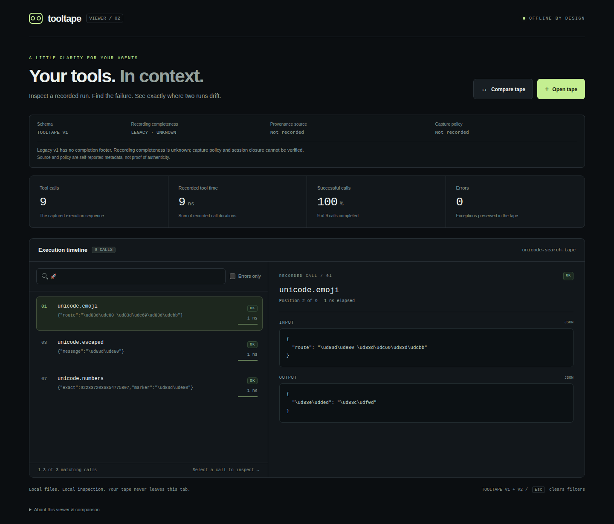
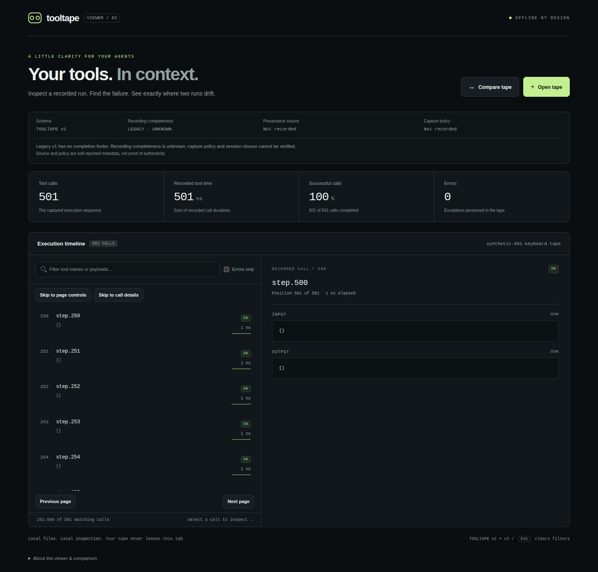

# ToolTape offline viewer

English | [简体中文](README.zh-CN.md)

Open [`index.html`](index.html) directly in a modern browser. There is no server, build step, dependency install, CDN, account, telemetry, or upload. The page reads only files you choose or drop into it. A Content Security Policy blocks network connections, external resources, forms, and embedded objects. Nothing is saved in browser storage.

## Inspect a tape

1. Click **Open tape** and choose a local `.tape` file, or drop one file onto the page.
2. Select a timeline card to inspect its input and recorded output or exception class.
3. Search tool names and payloads, or enable **Errors only**. Press **Esc** to clear filters.
4. Click **Compare tape** to select a second run. The comparison shows the first divergent position; **Inspect divergence** selects it and displays both recorded calls.

**Try an example** preserves a small, clearly labeled legacy v1 in-memory fixture, matching `fixtures/weather-retry.tape`, including one I/O exception and a successful retry. It performs no tool calls and requires no external file.

Files are limited to 16 MiB and 50,000 calls. The timeline renders at most 250 matching cards per page. **Previous page** and **Next page** replace the visible page; the footer reports its one-based range and total matching count. Jumping to a late divergence opens its page without rendering preceding pages. Paging keeps the inspector selection, even when that selected call is on another page. Very large payload panels display the first 100,000 characters with a visible notice; search and comparison still use complete values. An invalid replacement file leaves the previous valid run intact. Opening a new primary tape clears the old comparison.

When a divergence exists only in the comparison, inspecting it remembers the last selected primary call. Clearing comparison restores that primary selection. Replacing comparison restores it only if the inspected position no longer exists in either tape; a still-present comparison-only call stays inspectable. Filters, current timeline page and focus are preserved, so the restored selection may be off-page. Opening a new primary starts from its first call and discards the previous bookmark; an empty primary keeps its empty explanation.

## Interrupted and repeated file loads

An unsuccessful replacement leaves the last valid primary/comparison visible. Re-selecting the same file is supported. Newer reads and comparison reset invalidate older pending results. Clearing comparison, or successfully opening a new primary, also removes an obsolete comparison failure notice. A still-relevant primary replacement failure or multi-file drop warning is preserved; success in the other load channel does not erase it. Starting another file read retains the existing behavior of clearing the previous notice.

## Unicode and escaped-text search

Search accepts Unicode characters from JSON keys and string values, including emoji such as `😀`, even when the inspector shows canonical surrogate escapes. It also keeps the original canonical-text matching behavior, so JSON escape spellings and exact numeric text remain searchable. This is a substring filter, not a JSON-value equality query.

String escapes are decoded **once** for the extra search view. A field containing the literal characters `\ud83d\ude00` does not become an emoji match. Searching that escape spelling can still match a canonical emoji representation or the literal text. Search uses JavaScript's locale-independent `toLowerCase()` with surrounding query whitespace trimmed, as before; it does not add Unicode normalization, accent removal, locale-specific matching or fuzzy matching. For example, composed `é` and `e` plus a combining accent remain different sequences.

The decoded view is transient, no longer than its canonical source in UTF-16 units before lowercasing, and is not retained as a per-call search index. Existing 16 MiB / 50,000-call input limits still apply; this is not a browser heap-size or latency guarantee. Display, canonical serialization, exact numbers and comparison semantics are unchanged. Searching neither changes nor redacts recorded values.



Actual synthetic nine-call recording: the rocket query finds three payloads while the inspector retains canonical escapes. [Capture provenance](../docs/images/viewer-unicode-search.json).

## Keyboard controls

- Tab reaches visible **Open tape** / **Compare tape** buttons, without stopping on the invisible file inputs. Enter or Space opens the normal browser file picker.
- Before the call list, **Skip to page controls** reaches the first enabled pagination button; it appears only when multiple matching pages exist. **Skip to call details** focuses the labeled inspector, including its empty or missing-primary explanation. Both keep the current selection and filters. From the first call, Shift+Tab reaches these shortcuts without traversing the other 249 cards. Enter or Space activates either native button; normal Tab navigation remains available.
- Activate **Previous page** or **Next page** to change pages; focus moves to the first call on that page while the selected inspection stays unchanged. Boundary buttons are disabled; controls are hidden when no second page exists.
- **Esc** clears active filters while keeping a focused call visible, or otherwise opening the selected call’s page. Filter controls retain focus. If a focused page button becomes unavailable, focus returns to a visible call. With no active filters, Esc leaves the current page, focus and selection unchanged.
- Activating **Clear comparison** returns focus to **Compare tape** and announces that the comparison was cleared. The primary selection remains intact.

These are targeted keyboard behaviors verified across the configured desktop/mobile-emulated browser projects. They are not a full accessibility audit or screen-reader compatibility certification.



A synthetic 501-call tape shows page 2 while retaining call 500 in the inspector. The native shortcuts avoid traversing all 250 cards. [Capture provenance](../docs/images/viewer-keyboard-shortcuts.json); control focus is cleared before capture, while focus/outline behavior is checked separately in all five browser projects.

## Text contrast

Small supporting text uses `#87948f` rather than the former `#65716e`. On the selected timeline background this raises the computed contrast ratio from about 3.04:1 to 4.89:1; on the standard panel it rises from about 3.56:1 to 5.72:1. The dark palette, primary text and status colors are retained.

Browser checks use actual computed colors, including transparency and opacity, for sampled labels, previews, placeholder text, footer content and call states (default, hover, selected and keyboard focus). They require at least 4.5:1 for these small-text samples, following the [W3C contrast-minimum explanation](https://www.w3.org/WAI/WCAG22/Understanding/contrast-minimum.html). Comparisons use unrounded ratios. [Verified measurements](../docs/contrast-results.json) record a lowest sampled ratio of 4.89479:1 across desktop/mobile Chromium, with source and run provenance.

This is targeted text-contrast verification in the existing dark theme, not a complete WCAG audit. Font readability, non-text controls, forced-colors modes, physical devices and assistive technologies require separate review.

## Recording details

The compact details panel shows the schema, recording completeness, provenance source, and shortened capture-policy SHA-256 identifier. Hover over the policy ID to inspect the full value; its accessible label also includes the full value. Metadata is self-reported and does not authenticate a recording.

- **SESSION CLOSED**: v2 contains a final, matching `END` count. The recording session closed; this does not prove business success. A recording with errors or zero calls can be closed.
- **INCOMPLETE**: v2 has valid metadata and event rows but no `END`. It stays inspectable with a visible warning that it cannot be used for safe replay.
- **LEGACY · UNKNOWN**: v1 has no metadata or completion footer. The original demo remains v1. Policy identity and recording completeness cannot be verified.

The comparison panel shows the second tape's schema, completeness, source, and policy separately. Different policy IDs generate a warning even when every recorded event matches. Legacy policy coverage is marked unverifiable.

## Format

The viewer accepts UTF-8 ToolTape v1 and v2 line-oriented TSV. The header is `TOOLTAPE` followed by a tab and `1` or `2`.

v1 contains event rows directly after the header. v2 requires a second line containing `META`, a tab, and unpadded base64url of exactly this canonical JSON object shape:

```json
{"policyId":"sha256:<64 lowercase hexadecimal characters>","source":"static.identifier"}
```

Metadata keys are ordered as shown with no insignificant whitespace. Both values must be strings; unknown, missing, or duplicate keys are rejected. `source` must match `[A-Za-z0-9_.:-]{1,128}`. Use a static provenance label, never a person's name, local path, credential, or other sensitive value.

After metadata, v2 uses the same event rows as v1. Its optional final line is `END`, a tab, and a canonical nonnegative decimal event count matching the number of rows. Leading zeros, a mismatched count, duplicate footers, or any row after `END` are rejected. Missing `END` is valid for inspection and is explicitly incomplete; a partial final line is still rejected.

Each event row contains exactly six tab-separated fields:

| Field | Meaning |
| --- | --- |
| `index` | Zero-based contiguous decimal call index |
| `durationNanos` | Nonnegative signed-64-bit decimal nanosecond duration |
| `toolName` | Unpadded base64url-encoded static UTF-8 tool identifier |
| `input` | Unpadded base64url-encoded canonical input JSON object |
| `status` | `OK` or `ERROR` |
| `output` | Unpadded base64url-encoded canonical JSON object for `OK`, or error class text for `ERROR` |

Files require UTF-8 without a BOM, LF line endings, and a final newline. Tool identifiers must match `[A-Za-z0-9_.:-]{1,128}`. Error class labels may contain qualified Unicode identifier segments, capped at 1,024 UTF-16 units, with control/format characters excluded. Inputs and successful outputs must be JSON objects; nested arrays and other JSON values are supported within those objects. Empty encoded fields decode successfully but fail these field-specific requirements. Malformed headers, columns, integers, status values, base64url, UTF-8, duplicate JSON keys, nesting beyond 64 levels, and invalid JSON produce an inline error with the line number where applicable. See [the v1/v2 format specification](../docs/FORMAT.md).

Raw JSON, canonical JSON and aggregate canonical event payloads each have a 16 MiB UTF-8 budget. Numeric tokens/plain-decimal output are limited to 10,000 characters and value trees to 100,000 nodes. Expansion is checked before padding allocation, so small exponent-encoded files cannot consume unbounded memory.

## Comparison rules

Calls are compared in recorded row order. The first difference in **index, tool name, canonical input text, status, or output/error text** is reported. A missing or extra call is a divergence at the first absent row. The displayed position is one-based; call indexes retain their recorded values.

Durations, metadata, and closure status are deliberately ignored for event equality: replay may have different timing while recording the same behavior. Policy differences and incomplete recordings remain separately visible. The viewer canonicalizes JSON object keys and decimal numbers to match the Java codec, so reordered object keys and `1.0` versus `1` compare equally. Numeric normalization is lossless, including integers outside JavaScript’s safe-integer range. Array order remains significant.

Recorded duration totals use `BigInt`, and JSON is parsed and pretty-printed without converting numeric literals through JavaScript floating-point values. Large integers remain exact. Tape-controlled strings are inserted using DOM `textContent`, never `innerHTML`, and are not interpreted as HTML, JavaScript, or clickable links.

Comparison only covers captured fields. Redacted or omitted fields cannot be checked, and equal tapes do not prove equality of excluded behavior. A valid tape does not prove the original business workflow completed.

The summary's recorded tool time is the sum of call durations, not wall-clock run time. “Successful calls” means status `OK`; the viewer does not evaluate a tool result's business meaning.

## Privacy

Tapes can contain sensitive tool arguments or outputs. The viewer does not redact them. Inspect and share tapes accordingly. Loaded data stays in this tab's memory; close or reload the page to discard it. Browser extensions and your operating system are outside this page's control.

## Reproducible checks

The viewer itself needs only a modern browser. For development checks, use **Node.js 18 or newer**; no packages or downloads are needed. From the repository root:

```sh
node viewer/test-core.cjs
node viewer/test-interactions.cjs
```

`test-core.cjs` extracts the actual inline viewer script and checks v1/v2 parsing, strict metadata fields/types/canonicalization, footer counts and placement, incomplete/empty sessions, the 50,000-call boundary, fixture parity, decimal canonicalization, exact large integers, malformed encodings, lexical indexes/durations, comparison, JSON pretty-printing, and network/storage-free implementation.

`test-interactions.cjs` executes that same script against a small DOM model and checks opening files, visible schema/completeness/provenance, policy mismatch warnings, error filtering, search reset, divergence inspection, missing calls, inline errors, interrupted and stale-read races, the file-size limit, and text-only rendering of HTML-like payloads. These are **not browser-rendering or accessibility tests**.

For real offline Chromium/Firefox/WebKit interactions, responsive-layout assertions, and baseline/diff/mobile screenshots, see [the browser-check instructions](browser-tests/README.md). The pinned development-only Playwright suite runs in [the browser CI workflow](../.github/workflows/browser.yml). It opens the same HTML directly from disk and uploads real screenshots with source/fixture provenance. [Verified five-project CI](https://github.com/keweizhuazuki/tooltape/actions/runs/38072059732) passed 343 tests (two duplicate mobile screenshot tests skipped), including 50,000-call last-divergence navigation. The selected real Chromium desktop/mobile screenshots were visually reviewed. Each published screenshot records its own capture run and source hash; the notice-lifecycle and selection-restoration fixes do not change the layout.

## Implementation and next verification

Completed: primary selection restoration after comparison-only inspection; comparison-scoped notice lifecycle for interrupted/repeated loads; native skip controls for direct page/details keyboard access; Unicode/emoji search with single-decoded string matching and unchanged canonical comparison; bounded 250-call pages, late-divergence navigation and truthful ranges; improved small-text contrast with computed browser checks; keyboard focus continuity and visible-only Tab navigation; v1 compatibility, strict v2 metadata and closure inspection, policy-aware comparison warnings, privacy-preserving text rendering, and reproducible dependency-free checks.

Next verification: keep screenshots synchronized with viewer changes; add physical-device testing, native Safari/iOS coverage and an assistive-technology audit of navigation and file-load feedback.
